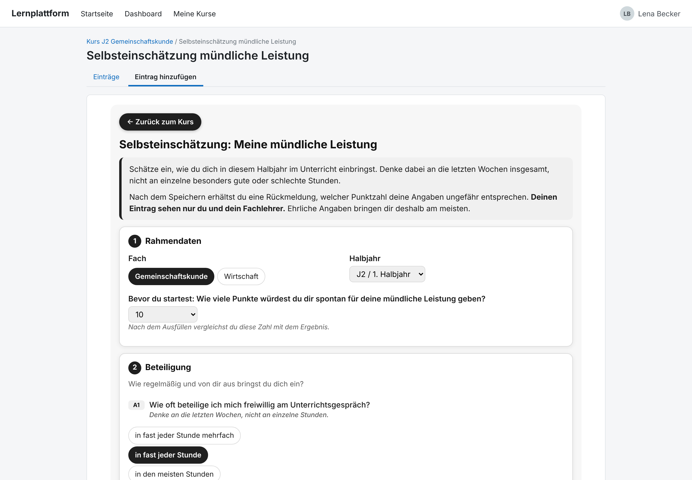
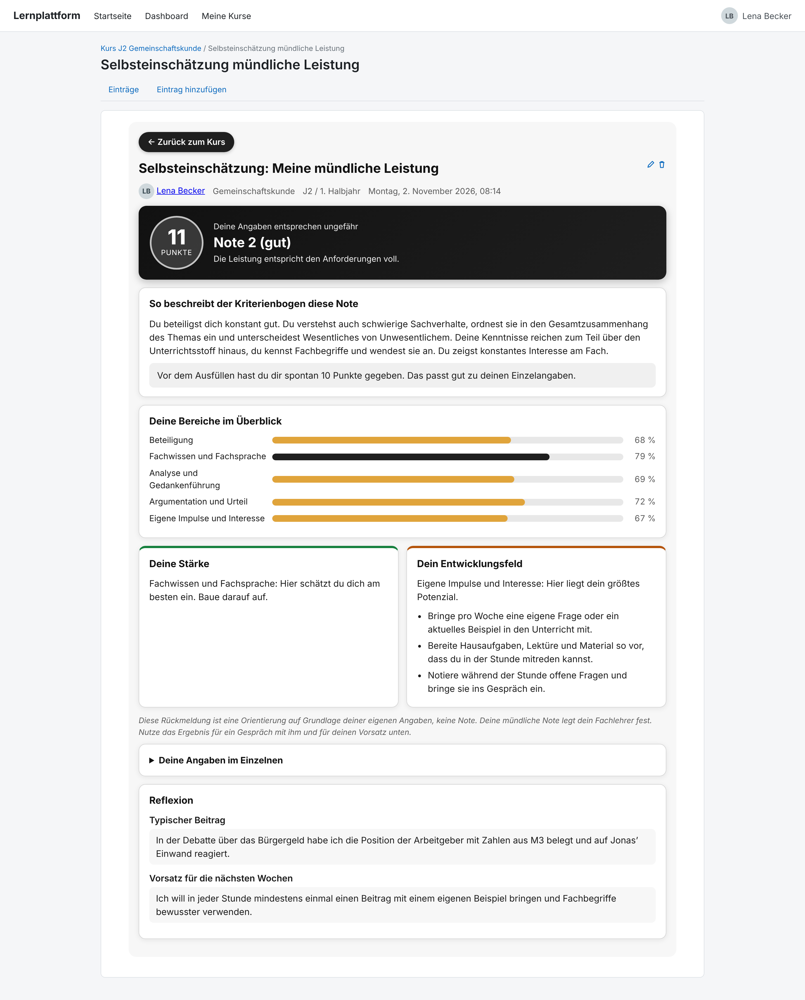
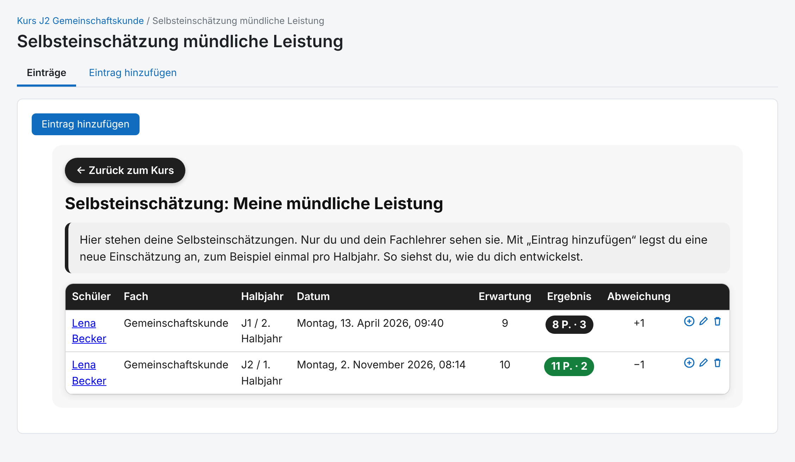
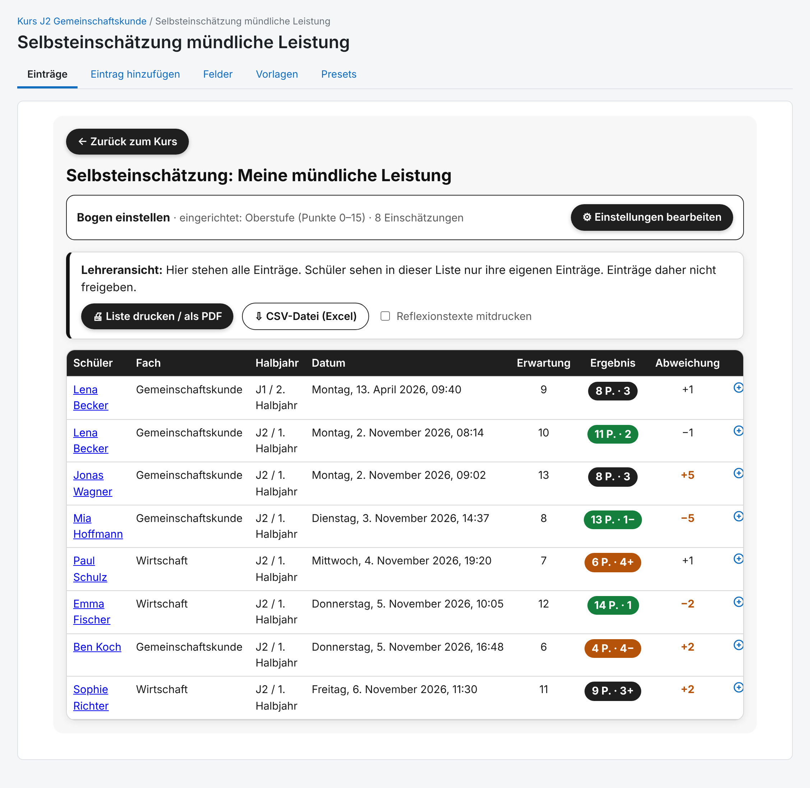
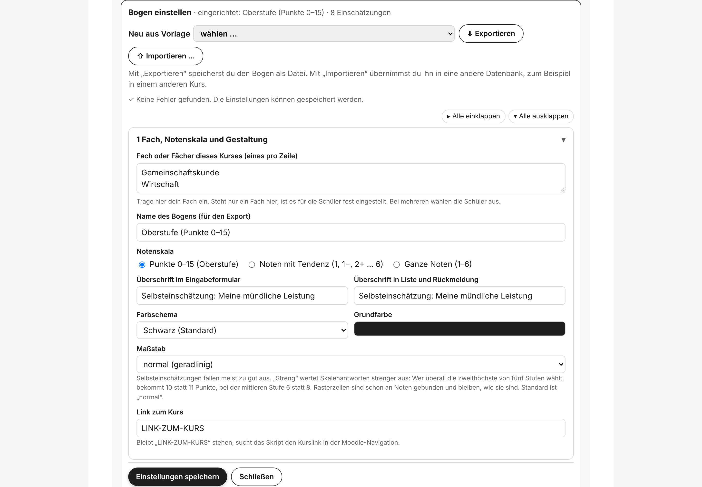

# Selbsteinschätzung mündliche Leistung – Moodle-Datenbankvorlage

Preset für die Moodle-Aktivität **Datenbank**. Schülerinnen und Schüler schätzen ihre mündliche Leistung mit einem Fragebogen selbst ein und erhalten sofort eine Rückmeldung. Die Lehrkraft richtet den Bogen direkt in Moodle ein und sieht alle Einträge in einer Übersicht.

## Funktionen

**Für Schüler**
- Fragebogen mit Rahmendaten (Fach, Halbjahr) und einer spontanen Ersteinschätzung
- Fragen in mehreren Bereichen (z. B. Beteiligung, Fachwissen, Analyse, Argumentation, eigene Impulse)
- Automatische Auswertung: Punkte bzw. Note, Beschreibung der Notenstufe, Vergleich mit der Ersteinschätzung
- Balken je Bereich, Stärke und Entwicklungsfeld mit konkreten Tipps
- Freiwillige Reflexion: typischer Beitrag und Vorsatz für die nächsten Wochen
- Eigene Einträge bleiben privat (nur Schüler und Lehrkraft sehen sie)

**Für Lehrkräfte**
- Bogen direkt in der Datenbank einstellen: Vorlage wählen (Oberstufe Punkte 0–15, Unter-/Mittelstufe Noten mit Tendenz, Fremdsprachen-Kriterienraster), Fächer, Fragen, Skalen, Gewichtung, Texte und Farbschema anpassen
- Einstellungen exportieren und in anderen Kursen importieren
- Übersicht aller Einträge mit Erwartung, Ergebnis und Abweichung
- Liste drucken bzw. als PDF speichern, Export als CSV-Datei (Excel)
- Warnhinweise, falls Einträge versehentlich freigegeben sind

## Installation

1. Im Kurs eine Aktivität **Datenbank** anlegen.
2. In den Einstellungen der Datenbank unter *Einträge* **„Freigabe erforderlich“ auf „Ja“** stellen.
3. Unter **Presets › Importieren** die Datei `Selbsteinschaetzung - Muendliche Leistung.zip` hochladen.
4. Die Datenbank öffnen, unter **„Bogen einstellen“** eine Vorlage wählen, anpassen und **„Einstellungen speichern“**.

> **Wichtig:** Einträge der Schüler **nie freigeben** – nur so bleiben sie für andere Kursteilnehmer unsichtbar. Der Einstellungseintrag der Lehrkraft ist automatisch freigegeben und darf nicht gelöscht werden.

## Screenshots

| Schüler: Fragebogen | Schüler: Auswertung |
|---|---|
|  |  |

| Schüler: eigene Einträge | Lehrkraft: Übersicht |
|---|---|
|  |  |

**Lehrkraft: Bogen einstellen**

*Die Screenshots zeigen Beispieldaten mit erfundenen Namen.*

## Lizenz

Wolfgang Schneider, [CC BY-SA 4.0](https://creativecommons.org/licenses/by-sa/4.0/deed.de)
